# Wine Quality — reproducible MLOps pipeline

[](https://github.com/santoshmyakala/wine-quality-mlops/actions/workflows/ci.yml)


An end-to-end, reproducible ML workflow around a small, well-understood problem: predicting the sensory **quality score (0–10)** of Portuguese *vinho verde* wines from 11 lab measurements.

The model is deliberately simple. The point of the repository is the **engineering around it**: a versioned DVC pipeline, MLflow experiment tracking and model registry, a containerised FastAPI service with Prometheus metrics, a hardened Helm chart, and CI that tests, retrains, builds, smoke-tests and scans the image on every change.

> Originally an exploratory notebook exercise from my PG Diploma in Machine Learning (Imarticus Learning); rebuilt in 2026 as a production-style reference implementation.

## Architecture

<picture>
  <source media="(prefers-color-scheme: dark)" srcset="docs/diagrams/architecture-dark.svg">
  
</picture>

### CI/CD

<picture>
  <source media="(prefers-color-scheme: dark)" srcset="docs/diagrams/ci-dark.svg">
  
</picture>

## Results

Produced by `dvc repro` with the committed `params.yaml` (random forest, seed 42) on a stratified 80/20 split — 5,197 training rows and 1,300 test rows:

| Metric (test set) | Random forest | Baseline: predict the mean |
|---|---:|---:|
| RMSE | **0.598** | 0.874 |
| MAE | **0.426** | 0.686 |
| R² | **0.532** | 0.000 |
| Exact grade (rounded prediction) | **69.0%** | 43.6% |
| Within ±1 grade | **97.4%** | 93.2% |

5-fold cross-validation on the training split: RMSE 0.615, R² 0.503.

These are the numbers from this repository's own pipeline run. Your results may differ slightly across library versions. Quality is a subjective, imbalanced label (most wines score 5–6), so an R² around 0.5 is typical for this dataset.

## Tech stack

| Concern | Tooling |
|---|---|
| Pipeline & reproducibility | DVC (`dvc.yaml`, `params.yaml`, `dvc.lock`) |
| Experiment tracking & registry | MLflow (local SQLite store by default; any server via `MLFLOW_TRACKING_URI`) |
| Modelling | scikit-learn (`RandomForestRegressor`, `HistGradientBoostingRegressor`, `Ridge`) |
| Serving | FastAPI, Pydantic validation, Uvicorn |
| Observability | Prometheus client metrics (`/metrics/`), health and readiness probes |
| Packaging | Multi-stage Dockerfile, non-root user, healthcheck |
| Deployment | Helm chart: HPA, resource limits, read-only root FS, dropped capabilities |
| CI | GitHub Actions: ruff, pytest, `dvc repro`, image build + smoke test, Trivy, GHCR, helm lint, kubeconform |

## Quick start

```bash
git clone https://github.com/santoshmyakala/wine-quality-mlops.git
cd wine-quality-mlops
python -m venv .venv && source .venv/bin/activate
pip install -e ".[train,dev]"
```

Run the tests, then reproduce the whole pipeline:

```bash
pytest -q
```

```bash
dvc repro && dvc metrics show
```

Re-running `dvc repro` without changes is a no-op. Change a value in `params.yaml` (for example `train.model: gradient_boosting`) and only the affected stages re-run.

### Experiment tracking

Every training run logs parameters, cross-validation and test metrics, the metrics report and the model, and registers a new version of `wine-quality-regressor`.

```bash
mlflow ui --backend-store-uri sqlite:///mlflow.db --port 5000
```

To log to a shared server instead, set the tracking URI before running the pipeline:

```bash
export MLFLOW_TRACKING_URI=https://mlflow.example.internal
```

### Serve the model locally

```bash
uvicorn wine_quality.api:app --port 8000
```

```bash
curl -s -X POST localhost:8000/predict -H 'content-type: application/json' -d '{
  "samples": [{
    "fixed acidity": 7.4, "volatile acidity": 0.7, "citric acid": 0, "residual sugar": 1.9,
    "chlorides": 0.076, "free sulfur dioxide": 11, "total sulfur dioxide": 34,
    "density": 0.9978, "pH": 3.51, "sulphates": 0.56, "alcohol": 9.4, "is_red": true
  }]
}'
```

Actual response from the committed model:

```json
{"predictions":[5.025],"model_version":"1.0.0"}
```

(That sample is the first row of the red-wine dataset, whose true quality is 5.)

| Endpoint | Purpose |
|---|---|
| `POST /predict` | Score 1–1,000 samples; inputs validated (non-negative concentrations, 0 < pH < 14) |
| `GET /healthz` | Liveness |
| `GET /readyz` | Readiness — 503 until the model is loaded |
| `GET /metrics/` | Prometheus: `wine_predictions_total`, `wine_predict_latency_seconds`, `wine_predicted_quality` |
| `GET /docs` | OpenAPI UI |

### Docker and Docker Compose

The image packages the model produced by `dvc repro`, so run the pipeline first.

```bash
docker build -t wine-quality-api:local .
```

```bash
docker compose up --build
```

Compose starts the API on `:8000` and Prometheus on `:9090`, already scraping the API.

### Kubernetes

```bash
helm install wine deploy/helm/wine-quality-api \
  --set image.repository=ghcr.io/santoshmyakala/wine-quality-mlops --set image.tag=<git-sha>
```

```bash
kubectl port-forward svc/wine-wine-quality-api 8000:80
```

The chart runs two replicas behind an HPA (2–6 pods at 70% CPU) and uses readiness and liveness probes. Pods run non-root with a read-only root filesystem, all Linux capabilities dropped and the `RuntimeDefault` seccomp profile. Prometheus scrape annotations are set on the pods.

## Project structure

```
├── data/raw/                 # UCI Wine Quality CSVs (CC BY 4.0)
├── src/wine_quality/
│   ├── prepare.py            # stage 1: merge, validate, stratified split
│   ├── features.py           # feature list + model pipeline factory
│   ├── train.py              # stage 2: CV, fit, MLflow logging + registry
│   ├── evaluate.py           # stage 3: test metrics vs mean baseline
│   └── api.py                # FastAPI service + Prometheus metrics
├── tests/                    # data, model-quality and API tests
├── dvc.yaml · params.yaml    # pipeline definition and hyper-parameters
├── Dockerfile · docker-compose.yml · monitoring/
├── deploy/helm/wine-quality-api/
└── .github/workflows/ci.yml
```

## Testing

`pytest -q` runs nine tests that cover:
- the data contract: columns, row counts, and that the split is deterministic and stratified;
- a **model-quality gate**: the model must beat the mean baseline and reach R² > 0.3;
- the API: health and readiness, prediction shape, input validation (422 responses) and the Prometheus metrics endpoint.

## Security considerations

- No credentials in the repository. CI pushes to GHCR with the short-lived `GITHUB_TOKEN`, scoped to `packages: write` on the image job only.
- The container runs as UID 10001. The Helm chart enforces a non-root user, a read-only root filesystem, no privilege escalation and dropped capabilities.
- Trivy fails the build on fixable HIGH or CRITICAL vulnerabilities.
- MLflow 3 stores scikit-learn models in skops format. Only `sklearn.tree._tree.Tree` is marked trusted, because the model is produced by this pipeline.
- `joblib` model files run code when loaded. Only load models that this pipeline built.

## Roadmap

- [ ] Data-drift monitoring: compare live feature distributions with the training set (Evidently), and expose a drift score as a Prometheus metric.
- [ ] Promote models with MLflow aliases (`@champion`) and have the API load from the registry.
- [ ] Optional remote DVC storage (S3) for larger, non-public datasets.
- [ ] Deploy to `kind` in CI and run an end-to-end test against the Helm release.
- [ ] Reduce image size, which is currently about 780 MB because of the scikit-learn, pandas and SciPy wheels.

## Licence and attribution

Code: MIT. Data: UCI Wine Quality (Cortez et al., 2009), CC BY 4.0 — see [`data/README.md`](data/README.md).
